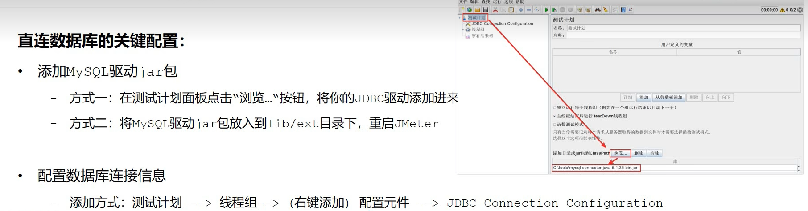
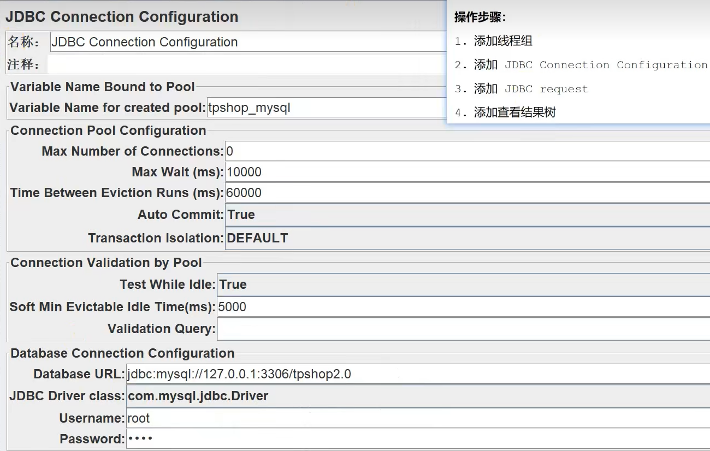
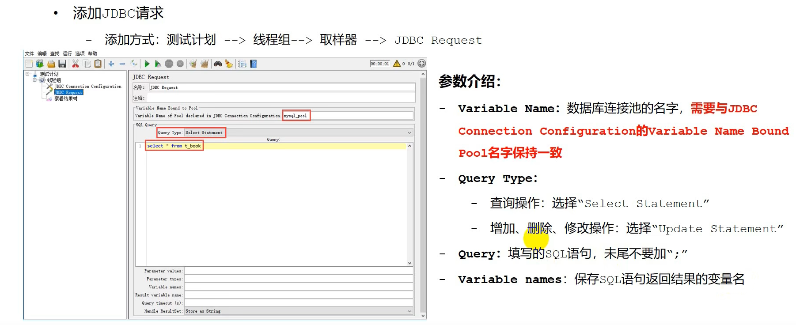

# Apache JMeter 性能测试 完整系统学习大纲

> 本文面向**测试工程师**，按"认知 → 环境 → 组件 → 脚本 → 场景 → 分析 → 调优 → 自动化"的顺序组织，由浅入深。
> JMeter 不难在"点哪里"，难在**怎么设计场景、怎么看懂结果、怎么判断这个数字是好是坏**。本文把这三件事讲透，配置类的内容都给可直接照抄的值。

## 一、JMeter 概述与性能测试基础

### 1.1 JMeter 是什么

Apache JMeter 是一个**纯 Java 的开源压测工具**，本质是"按你设定的节奏，模拟很多用户同时向服务器发请求，并记录每次请求花了多久"。

> 💡 **通俗类比**：功能测试是你自己拿一个遥控器按一下、看灯亮不亮；性能测试是你雇 200 个人，按同一份说明书、以规定节奏反复按遥控器，同时拿秒表记录每次亮的耗时。JMeter 就是那个"发说明书 + 掐秒表"的工具。

| 能做什么 | 不能做什么 |
| :--- | :--- |
| HTTP/HTTPS、REST、SOAP 接口压测 | **不渲染页面、不执行 JavaScript**（它不是浏览器） |
| JDBC 数据库、JMS、MQTT、FTP、SMTP 压测 | 不能测前端页面渲染耗时（那是 Lighthouse 的活） |
| 参数化、关联、断言、分布式压测 | 不直接给出"系统能扛多少用户"的结论（要人分析） |
| 生成 HTML 报告、与 CI 集成 | **压测机自己也会成为瓶颈**，结果不一定代表服务端 |

特性：开源免费、跨平台（Windows / Linux / macOS 都是同一套 `.jmx`）、多协议、插件生态丰富、**GUI 只用来写脚本，真正压测必须走命令行**。

### 1.2 性能测试的几种类型

| 类型 | 目的 | 典型做法 | 关注指标 |
| :--- | :--- | :--- | :--- |
| **基准测试** | 建立一条"正常水平"的基线 | 单用户 / 低并发跑一轮 | 单请求 RT、TPS |
| **负载测试** | 验证预期负载下是否达标 | 逐步加压到目标并发 | RT、错误率、资源利用率 |
| **压力测试** | 找系统的极限与崩溃点 | 一直加压直到出错或 RT 陡增 | 最大 TPS、崩溃并发数 |
| **稳定性测试**（疲劳/浸泡） | 找长时间运行才暴露的问题 | 目标负载跑 1~12 小时 | 内存泄漏、连接池耗尽、TPS 衰减 |
| **并发测试** | 验证同一时刻的抢资源逻辑 | 用同步定时器制造瞬间并发 | 超卖、死锁、数据错乱 |
| **容量测试** | 算出满足指标的最大容量 | 阶梯加压 + 数据量的组合 | 容量拐点、扩容建议 |

> 一句话：**负载测试看"达标没"，压力测试看"什么时候垮"，稳定性测试看"跑久了会不会垮"。**

### 1.3 核心指标（面试与报告都绕不开）

| 指标 | 含义 | 怎么算 / 怎么看 |
| :--- | :--- | :--- |
| **并发用户数** | 同时在向系统施压的虚拟用户 | JMeter 里就是"线程数"，**不等于在线用户数** |
| **响应时间 RT** | 从发出请求到收完响应的时间 | 看平均值更要看 **P95 / P99** |
| **TPS / QPS** | 每秒完成的事务数 / 请求数 | 一个事务含多个请求时，TPS ≠ 请求数 |
| **吞吐量** | 单位时间处理的请求量 | 服务器忙不过来时会**见顶回落** |
| **错误率** | 失败请求 / 总请求 | 一般要求 **< 0.1%**，金融类常要求 0 |
| **资源利用率** | CPU、内存、磁盘 I/O、网络 | CPU > 80% 且 TPS 不涨，通常已到瓶颈 |

> 💡 **通俗理解**：把系统想成奶茶店——**并发数**是排队的人，**RT** 是每个人从点单到拿到奶茶的时间，**TPS** 是每分钟出杯数。人一直加到 100，出杯数却卡在每分钟 30 杯不再涨，多出来的人只是让队伍（RT）变长，这时**瓶颈就在出杯能力**上，加人没用。

**并发数换算（场景设计最常用的一个公式）**

```text
并发用户数 ≈ TPS × 平均响应时间（秒）

例：目标 TPS = 100，接口平均 RT = 0.2s
    → 需要并发 ≈ 100 × 0.2 = 20 个线程
    （若算出 20 但压不上去，说明 RT 变长或系统已达瓶颈）
```

> 这个公式是**估算起点**，不是精确值；实际要靠阶梯加压实测校准。

### 1.4 与同类工具对比

| 工具 | 脚本形式 | 优势 | 适合场景 |
| :--- | :--- | :--- | :--- |
| **JMeter** ★ | GUI / `.jmx` (XML) | 零代码、协议全、资料多、国内岗位通用 | 接口压测、团队协作、CI 集成 |
| LoadRunner | C / JS | 商业级、协议最全、报告专业 | 传统企业、大型综合场景 |
| Locust | Python 代码 | 灵活、单机并发高、易写复杂逻辑 | 开发自测、定制化场景 |
| Gatling | Scala / DSL | 报告漂亮、资源占用低 | 偏工程化的团队 |
| k6 | JavaScript | 云原生、对 CI 友好 | 现代化流水线、SRE 团队 |

> 测试岗位**先掌握 JMeter** 性价比最高：招聘要求里出现频率最高，且图形化界面便于和开发、产品对结果。

### 1.5 JMeter 架构与核心组件

```text
测试计划 (Test Plan)                 ← 根节点，整个脚本的容器
└── 线程组 (Thread Group)            ← 定义"多少用户、怎么加压、跑多久"
    ├── 配置元件 (Config Element)    ← 请求默认值、请求头、CSV 数据、变量
    ├── 前置处理器 (Pre Processor)   ← 请求发出前：改参数、生成签名
    ├── 定时器 (Timer)               ← 控制请求节奏、制造集合点
    ├── 逻辑控制器 (Logic Controller)← 决定请求执行顺序 / 次数 / 条件
    ├── 取样器 (Sampler) ★           ← 真正发请求的那一步
    │   └── 断言 (Assertion)         ← 判断这次响应算成功还是失败
    ├── 后置处理器 (Post Processor)  ← 请求回来后：提取 Token、存变量
    └── 监听器 (Listener)            ← 记录 / 展示结果
```

| 组件 | 作用 | 类比 |
| :--- | :--- | :--- |
| 测试计划 | 根节点，保存为 `.jmx` | 一份测试方案 |
| 线程组 | 模拟并发用户的单元 | 一批"虚拟用户" |
| 取样器 | 发请求（HTTP / JDBC / JMS…） | 用户的一次点击 |
| 逻辑控制器 | 控制执行顺序、循环、条件 | 脚本里的 if / for |
| 配置元件 | 提供公共配置与测试数据 | 公共参数表 |
| 前置 / 后置处理器 | 请求前造数据、请求后提数据 | 前置准备 / 结果回收 |
| 断言 | 判断响应是否符合预期 | 检查点 |
| 定时器 | 控制发送节奏 | 思考时间 / 集合口令 |
| 监听器 | 收集展示结果 | 秒表 + 记录本 |

**工作原理**：每个线程独立、顺序地执行一遍测试计划；所有线程同时跑 → 形成并发。JMeter **不模拟浏览器渲染**，只发协议报文，所以单机能撑起几千线程（前提是用非 GUI 模式且脚本精简）。

### 1.6 一次压测的标准流程

1. **明确需求**：哪个接口、目标 TPS / RT / 错误率是多少、数据量多大
2. **准备环境**：独立的压测机 + 尽量接近生产的被测环境 + 铺底数据
3. **写脚本**：单用户跑通 → 加断言 → 参数化 → 关联 → 加事务控制器
4. **调试**：GUI 模式 1 线程 1 循环，用"查看结果树"确认每个请求都成功
5. **设计场景**：定并发数、Ramp-Up、持续时间、加压曲线
6. **执行**：**非 GUI 模式**跑，同时监控服务端资源
7. **分析**：先看错误率，再看 RT 百分位与 TPS 曲线，最后结合资源定位瓶颈
8. **回归与报告**：调优后重跑，对比基线，输出结论

> 一句话：**脚本写对只算 30 分，场景设计对 60 分，能读懂曲线并给出结论才及格。**

## 二、环境搭建与第一个测试计划

### 2.1 安装与目录结构

| 项 | 要求 | 说明 |
| :--- | :--- | :--- |
| JDK | **JDK 8 / 11 / 17**（JMeter 5.6+ 需 Java 8+） | 配好 `JAVA_HOME` 与 `PATH` |
| 内存 | 压测机建议 ≥ 4 GB 空闲 | JMeter 自身吃内存 |
| 下载 | 官网 `apache-jmeter-5.6.3.zip`（Binary 包） | 解压即用，无需安装 |
| 版本 | 分布式时**所有机器版本必须完全一致** | 版本不一致是分布式最常见的坑 |

```bash
# Windows（PowerShell 或 cmd）验证 Java
java -version
echo %JAVA_HOME%

# 启动 GUI（进入解压后的 bin 目录）
.\jmeter.bat

# Linux / macOS
./jmeter
```

| 目录 | 内容 | 常改的东西 |
| :--- | :--- | :--- |
| `bin/` | 启动脚本、`jmeter.properties`、`jmeter.bat` | JVM 堆内存、语言、报告配置 |
| `lib/` | 核心 jar、`ext/` 放插件 jar | JDBC 驱动、插件 |
| `extras/` | 样例、Ant 构建脚本 | 生成报告模板 |
| `docs/` | 本地 API 文档 | 查组件用法 |

```properties
# bin/jmeter.properties：切换中文界面（改完重启 GUI）
language=zh_CN

# 结果文件默认存 CSV（比 XML 更省空间，推荐）
jmeter.save.saveservice.output_format=csv
```

### 2.2 GUI 模式 vs 非 GUI 模式

| 维度 | GUI 模式 | **非 GUI 模式（压测必用）** |
| :--- | :--- | :--- |
| 用途 | 写脚本、调试 | 正式执行压测 |
| 资源消耗 | 高（监听器实时画图） | 低 |
| 结果展示 | 实时看树/图 | 写 `.jtl`，事后生成 HTML 报告 |
| 能否大规模并发 | 否，容易把本机压垮 | 是 |

> ⚠️ **新手最常见的错误**：开着 GUI、挂着"查看结果树"跑 500 并发。结果不是被测系统垮，是**JMeter 自己先 OOM**，数据全不可信。

### 2.3 第一个 HTTP 压测脚本（照着点一遍就会）

以 `GET http://httpbin.org/get` 为例，目标：10 个并发、10 秒内启动完、每线程跑 5 轮。

| 步骤 | 操作 | 填什么 |
| :--- | :--- | :--- |
| 1 | 右键 测试计划 → 添加 → 线程（用户）→ 线程组 | 线程数 `10`，Ramp-Up `10`，循环次数 `5` |
| 2 | 右键 线程组 → 添加 → 配置元件 → HTTP 请求默认值 | 协议 `http`，服务器名称 `httpbin.org`，端口 `80` |
| 3 | 右键 线程组 → 添加 → 取样器 → HTTP 请求 | 方法 `GET`，路径 `/get` |
| 4 | 右键 HTTP 请求 → 添加 → 断言 → 响应断言 | 要测试的响应字段 `响应代码`，匹配规则 `等于`，模式 `200` |
| 5 | 右键 线程组 → 添加 → 监听器 → 查看结果树 | 调试用，看每个请求详情 |
| 6 | 右键 线程组 → 添加 → 监听器 → 聚合报告 | 看汇总指标 |
| 7 | 工具栏 ▶ 运行 | 1 线程先跑通，再改回 10 |
| 8 | 保存为 `first-test.jmx` | 脚本是 XML，建议入 Git |

**HTTP 请求取样器关键字段说明**

| 字段 | 作用 | 易错点 |
| :--- | :--- | :--- |
| 协议 | `http` / `https` | 留空会默认 http，https 必须显式填 |
| 服务器名称或 IP | 域名或 IP | **不要带 `http://` 和路径** |
| 端口号 | 80 / 443 / 8080 | 与协议对应 |
| 方法 | GET / POST / PUT / DELETE | POST 的 body 要写在"消息体数据"页 |
| 路径 | `/api/v1/login` | 参数可写在下方"参数"表，也可拼在路径 |
| 内容编码 | `UTF-8` | 中文乱码时填这个 |
| 跟随重定向 / 使用 KeepAlive | 勾选项 | 压测一般保持 KeepAlive，更贴近真实 |

### 2.4 调试期 vs 压测期的监听器配置

| 元件 | 调试期 | 正式压测 |
| :--- | :--- | :--- |
| 查看结果树 | ✅ 开，看请求/响应明细 | ❌ **必须禁用**（右键 → 禁用） |
| 聚合报告 / 汇总报告 | ✅ 开 | ❌ 禁用 |
| 图形结果 / 响应时间图 | 可选 | ❌ 禁用 |
| **简单数据写入器** | 可选 | ✅ 只保留它，把结果写入 `.jtl` |
| 后端监听器 | 可选 | ✅ 需要实时看板时才开（InfluxDB + Grafana） |

> 一句话：**监听器是"录像机"，调试时开着看细节，正式比赛要把录像机关掉，否则它自己先累趴。**

### 2.5 `.jmx` 脚本长什么样

```xml
<jmeterTestPlan version="1.2" properties="5.0" jmeterVersion="5.6.3">
  <hashTree>
    <TestPlan guiclass="TestPlanGui" testname="第一个测试计划" enabled="true">
      <stringProp name="TestPlan.comments">压测脚本说明写这里</stringProp>
    </TestPlan>
    <hashTree>
      <ThreadGroup guiclass="ThreadGroupGui" testname="线程组" enabled="true">
        <stringProp name="ThreadGroup.num_threads">10</stringProp>
        <stringProp name="ThreadGroup.ramp_time">10</stringProp>
      </ThreadGroup>
    </hashTree>
  </hashTree>
</jmeterTestPlan>
```

> ⚠️ 了解结构即可，**不要手工改 `.jmx`**：节点靠 `<hashTree>` 表达父子关系，手改极易把树改坏。要批量改参数，用命令行 `-J` 属性（见 5.4）或 GUI 里改。

### 2.6 启动 / 运行常见报错

| 报错 | 原因 | 解决 |
| :--- | :--- | :--- |
| `Not able to find Java executable` | 没装 JDK 或 `JAVA_HOME` 不对 | 装 JDK 并配环境变量 |
| `Unsupported major.minor version` | JDK 版本低于 JMeter 要求 | 升 JDK 到 8+ |
| GUI 一启动就卡死 | 堆内存太小 / 装了过多插件 | 调 `HEAP`（见 9.1）、清理 `lib/ext` |
| 中文响应乱码 | 未指定编码 | HTTP 请求填内容编码 `UTF-8`，或改 `jmeter.properties` 的 `samplers.results.default.encoding` |

## 三、核心组件深度解析

### 3.1 线程组：并发模型的心脏

| 参数 | 含义 | 举例 / 建议 |
| :--- | :--- | :--- |
| 线程数 | 虚拟用户数 | 由 1.3 的公式估算，从低往高阶梯试 |
| **Ramp-Up 时间（秒）** | 用多长时间把线程全部启动 | 100 线程 / 10 秒 = 每秒起 10 个 |
| 循环次数 | 每线程跑几遍 | 调试填 1；压测用"永远"+ 调度器持续时间 |
| 调度器 / 持续时间 | 跑多久自动停 | 稳定性测试设 3600 秒以上 |
| 启动延迟 | 多久后开始 | 多脚本联动时错开 |
| Same user on each iteration | 是否复用会话/Cookie | 登录态场景要勾 |

**Ramp-Up 怎么定**：太短 = 一瞬间把连接打满，容易测出"连接建立失败"而非业务瓶颈；太长 = 迟迟达不到目标并发。经验值：**`Ramp-Up ≈ 线程数 / 10`，且不短于 5 秒**；压测报告里必须记录这个值，否则结果无法复现。

| 特殊线程组 | 用途 |
| :--- | :--- |
| `setUp Thread Group` | 压测前跑：准备数据、批量登录取 Token |
| `tearDown Thread Group` | 压测后跑：清理测试数据 |
| 普通线程组 | 真正的压测主体 |

### 3.2 取样器

| 取样器 | 用途 | 关键配置 |
| :--- | :--- | :--- |
| **HTTP 请求** ★ | REST / Web 接口 | 见 2.3 |
| JDBC Request | 直连数据库压 SQL | 需 JDBC Connection Configuration + 驱动 jar |
| JSR223 Sampler | 自定义逻辑（Groovy） | 复杂签名、加解密、特殊协议 |
| JMS / MQTT / SMTP / FTP | 消息、邮件、文件 | 对应协议插件 |
| Debug Sampler | 打印所有变量 | **调试神器**，压测必删 |

```sql
-- JDBC Request 里可写参数化 SQL（占位符用 ? ，参数值用 ${uid} 传）
SELECT id, username, status FROM t_user WHERE id = ?;
```

### 3.3 逻辑控制器

| 控制器 | 作用 | 典型场景 |
| :--- | :--- | :--- |
| 简单控制器 | 纯分组，不改变逻辑 | 把"登录模块"收进一个文件夹 |
| 循环控制器 | 子元素重复 N 次 | 一个用户连续查 5 次 |
| 仅一次控制器 | 每线程只执行一次 | **登录只做一次**，后续只跑业务 |
| **事务控制器** ★ | 把多个请求合成一个事务 | 统计"下单"整体 RT 与 TPS |
| 如果（If）控制器 | 条件成立才执行 | 上一步成功才继续 |
| ForEach 控制器 | 遍历一组变量 | 批量处理提取出的多个 ID |
| 交替 / 随机 / 随机顺序 | 分支选择 | 模拟不同用户走不同路径 |
| 吞吐量控制器 | 按百分比分配请求 | 80% 查询 + 20% 下单的混合场景 |

> 💡 **事务控制器**是报告可读性的关键：勾上"Generate parent sample"后，聚合报告里只出现一行"下单事务"，而不是 5 个零散接口。

### 3.4 配置元件

| 元件 | 作用 | 必记要点 |
| :--- | :--- | :--- |
| HTTP 请求默认值 | 抽取公共的协议/域名/端口 | 改环境只改这一处 |
| HTTP 信息头管理器 | 加 `Content-Type`、`Authorization` | `application/json` 必须加，否则 body 不被解析 |
| HTTP Cookie 管理器 | 自动维持会话 | 有登录态就要加 |
| **CSV 数据文件设置** | 从 CSV 读测试数据 | 详见 4.2 |
| 用户定义的变量 | 定义 `${host}` 等静态值 | 环境切换靠它 |
| 计数器 / 随机变量 | 生成序号、随机数 | 造不重复数据 |
| JDBC Connection Configuration | 数据库连接池 | 变量名要在 JDBC Request 里引用 |

**作用域规则（最容易被忽略的一条）**：配置元件、前置/后置处理器、断言、定时器**对它所在层级的同级及所有下级生效**。

```text
测试计划
├── 用户定义的变量          → 对所有线程组生效
└── 线程组 A
    ├── HTTP 信息头管理器    → 只对 A 下的请求生效
    └── HTTP 请求 1
线程组 B                    → 拿不到 A 的头管理器
```

> 一句话：**放得越高，管得越宽**。发现某个请求"莫名其妙带了/没带某个头"，先往上找配置元件。

### 3.5 定时器：控制节奏

| 定时器 | 行为 | 用途 |
| :--- | :--- | :--- |
| 固定定时器 | 每个请求前等固定毫秒 | 模拟思考时间 |
| 高斯 / 均匀随机定时器 | 等待时间随机波动 | 更接近真人 |
| **同步定时器（Synchronizing Timer）** | 攒够 N 个线程再一起放 | **秒杀、抢购、并发抢锁** |
| **常数吞吐量定时器** | 把 TPS 限制在目标值 | 按"每分钟多少请求"定量施压 |
| 精准吞吐量定时器 | 更精细的 TPS 控制 | 插件提供 |

```text
常数吞吐量定时器换算：
目标 60 QPS → "每分钟目标吞吐量" 填 3600（60 × 60）
作用于"所有活动线程"时，实际 TPS = 设定值 / 60
注意：它是"限速"，压不上去时不会帮你加压，只能限制上限。
```

> ⚠️ 定时器在**每个取样器之前**执行，且对该作用域内所有取样器生效。若只想让某一个请求停顿，把定时器拖成该请求的**子元素**。

### 3.6 前置处理器与后置处理器

| 类型 | 元件 | 用途 |
| :--- | :--- | :--- |
| 前置 | 用户参数 | 给不同线程分配不同值 |
| 前置 | **JSR223 前置处理器（Groovy）** | 生成时间戳、签名、加密参数 |
| 前置 | HTML 链接解析器 | 解析页面里的链接（爬取型脚本） |
| 后置 | **正则表达式提取器** | 通用，能提任意文本 |
| 后置 | **JSON 提取器 / JSON JMESPath** | 提 JSON 响应字段，首选 |
| 后置 | XPath / 边界提取器 | XML / 固定边界文本 |
| 后置 | JSR223 后置处理器 | 复杂加工、跨线程组传值 |

**作用域提醒**：原稿把"正则表达式提取器"同时列在前置和后置两处，实际它属于**后置处理器**（必须先拿到响应才能提取）。

### 3.7 断言：决定"这次请求算不算成功"

| 断言 | 检查什么 | 建议 |
| :--- | :--- | :--- |
| 响应断言 | 响应代码 / 响应文本 / 响应头 | **每个接口至少一个状态码断言** |
| JSON 断言 / JSON Path 断言 | JSON 字段值 | 校验 `code = 0` 这类业务码 |
| 持续时间断言 | RT 是否超阈值 | 快速标出慢请求 |
| 大小断言 | 响应字节数 | 防止返回错误页却 200 |
| JSR223 断言 | 自定义复杂判断 | 签名校验、多字段联合判断 |

> ⚠️ **两个常见坑**：
> ① 只断言 HTTP 200 —— 很多系统业务失败也返回 200 + `{"code":500}`，必须再断言业务码；
> ② 断言开太多 / 每个响应全文匹配 —— 断言本身消耗 CPU，压测时只保留最关键的 1~2 个。

### 3.8 监听器

| 监听器 | 用途 | 压测时 |
| :--- | :--- | :--- |
| 查看结果树 | 逐条看请求/响应 | ❌ 禁用 |
| 聚合报告 / 汇总报告 | 汇总统计 | ❌ 禁用 |
| 用表格查看结果 | 列表形式看每条 | ❌ 禁用 |
| 响应时间图 / 活跃线程数图 | 实时曲线 | ❌ 禁用 |
| **简单数据写入器** | 写 `.jtl` / `.csv` | ✅ 保留 |
| **后端监听器** | 推 InfluxDB → Grafana 实时看板 | ✅ 可选 |

### 3.9 元件执行顺序（面试常问）

```text
1. 配置元件（Configuration elements）
2. 前置处理器（Pre-Processors）
3. 定时器（Timers）
4. 取样器（Sampler）            ← 真正发请求
5. 后置处理器（Post-Processors） （仅在有结果时执行）
6. 断言（Assertions）            （仅在有结果时执行）
7. 监听器（Listeners）           （仅在有结果时执行）
```

> 记住这个顺序能解释很多"诡异现象"：比如**定时器在取样器之前**，所以"固定定时器"是请求前等待；**后置处理器在断言之前**，所以可以先把响应里的值存进变量、再用断言检查它。

<details markdown="1">
<summary>展开：JMeter 直连数据库（配置截图与取值规则）</summary>







1. 把对应数据库的驱动 jar（如 `mysql-connector-j-8.x.jar`）放进 `lib/ext/`，重启 JMeter。
2. 添加 **JDBC Connection Configuration**：填 `jdbc:mysql://host:3306/db?useSSL=false&serverTimezone=Asia/Shanghai`、驱动类 `com.mysql.cj.jdbc.Driver`、账号密码，并给连接池起一个变量名（如 `mysqlPool`）。
3. 添加 **JDBC Request**：`Variable Name of Pool` 填 `mysqlPool`，`Query Type` 选 `Select Statement` / `Prepared Select Statement`，写 SQL。
4. 查询结果在 **Variable names** 处定义变量接收，取用时要**用下划线接下标（从 1 开始）**，因为返回结果是一个类似列表的结构：`${id_1}` 取第一行的 id。可以加一个 **Debug Sampler** 查看 request 返回的响应内容与所有变量名。

| 易错点 | 说明 |
| :--- | :--- |
| 驱动没放 / 版本不对 | 报 `Cannot load JDBC driver class` |
| 连接池变量名不一致 | 报 `No pool found named: 'xxx'` |
| 下标从 0 开始取 | 实际**从 1 开始**，取不到值 |
| 用 Select Statement 写多条 SQL | 需改 `Callable Statement` 并配 `allowMultiQueries=true` |

> 直连数据库压测适合**单独测 SQL / 存储过程**；测业务接口性能时不要绕开应用服务器，否则测出来的数字对线上没有参考价值。

</details>

## 四、脚本开发与关联实战

### 4.1 参数化的三种方式

| 方式 | 适用 | 优点 | 缺点 |
| :--- | :--- | :--- | :--- |
| 用户定义的变量 | 少量固定值（host、env） | 简单 | 不能一线程一变 |
| **CSV 数据文件设置** ★ | 大量账号、订单号等 | 数据可复用、易维护 | 分布式时每台压力机都要放一份 CSV |
| 函数助手（`__Random` 等） | 临时造不重复值 | 无需文件 | 不可控、难复现 |

> 一句话：**固定配置用变量，批量数据用 CSV，临时造数用函数。**

### 4.2 CSV 数据文件设置（逐字段）

```csv
username,password,userId
test001,Pass@123,1001
test002,Pass@123,1002
test003,Pass@123,1003
```

| 字段 | 填什么 | 说明 |
| :--- | :--- | :--- |
| 文件名 | `data/users.csv` | 建议用相对路径，随脚本一起入 Git |
| 文件编码 | `UTF-8` | 中文数据必填 |
| 变量名称 | `username,password,userId` | 与 CSV 表头对应，用 `${username}` 引用 |
| 忽略首行 | `True`（有表头时） | 否则第一行会被当成数据 |
| 分隔符 | `,` | 与文件一致 |
| 是否允许带引号 | `False` | 数据里含逗号时改 True |
| **遇到文件结束符再次循环** | `True` | 数据量 < 总请求数时必须开 |
| **遇到文件结束符停止线程** | `False` | 与上一项二选一，别同时开 |
| 线程共享模式 | `所有线程` / `当前线程组` | 想让每个用户固定用自己那行，选"当前线程"相关模式 |

> ⚠️ 分布式压测时，**CSV 不会自动分发**：必须在每台 Slave 机的相同路径放一份，且内容最好按机器拆分，避免多机重复用同一批账号导致数据冲突。

### 4.3 关联：从登录响应里取 Token（完整实操）

**是什么**：服务器返回的值是动态的（Token、订单号、验证码），后续请求必须带上它 —— 把"上一步的响应"变成"下一步的入参"，就叫**关联**。

**为什么必须做**：不关联的话，脚本所有用户都拿同一个 Token，要么 401，要么压的是缓存里的假数据，结果完全失真。

| 步骤 | 操作 |
| :--- | :--- |
| 1 | 先跑一次登录，在"查看结果树"里把响应 JSON 复制出来 |
| 2 | 右键登录请求 → 添加 → 后置处理器 → **JSON 提取器** |
| 3 | 填变量名 `token`，JSONPath 表达式 `$.data.accessToken`，匹配数字 `1`，默认值 `NOT_FOUND` |
| 4 | 后续请求加 HTTP 信息头管理器：`Authorization: Bearer ${token}` |
| 5 | 加断言校验后续请求返回 200，且业务码正常 |
| 6 | 用 Debug Sampler 确认 `token` 确实取到了值 |

```json
{
  "code": 0,
  "message": "success",
  "data": {
    "accessToken": "eyJhbGciOiJIUzI1NiJ9...",
    "expiresIn": 7200
  }
}
```

```text
JSON 提取器 vs 正则表达式提取器

JSONPath（推荐，结构清晰）
  $.data.accessToken        → 取 data 下的 accessToken
  $.data.orders[0].id       → 取数组第一个元素的 id
  $.data.users[*].id        → 取全部 id（配合 ForEach 遍历）

正则提取器（响应不是 JSON 时用）
  引用名称：token
  正则表达式："accessToken":"(.+?)"
  模板：$1$
  匹配数字：1
  缺省值：NOT_FOUND
```

> ⚠️ **跨线程组传值**：JMeter 变量是**线程私有**的，线程组 A 提取的 `${token}` 在线程组 B 里取不到。要用 `__setProperty` 转成全局属性，或用 `setUp 线程组` + BeanShell/JSR223 写文件再读。

```groovy
// JSR223 后置处理器：把线程私有变量提升为全局属性
props.put("globalToken", vars.get("token"));
// 另一个线程组里用：${__P(globalToken,)}
```

### 4.4 常用函数

| 函数 | 作用 | 示例 |
| :--- | :--- | :--- |
| `${__time(yyyyMMddHHmmss,)}` | 当前时间 | 造时间戳 |
| `${__Random(1,1000,)}` | 随机数 | 造不重复参数 |
| `${__counter(,)}` | 计数器 | 全局递增序号 |
| `${__threadNum}` | 当前线程号 | 排查数据冲突 |
| `${__UUID}` | 生成 UUID | 唯一订单号 |
| `${__P(threads,10)}` | 读命令行属性 | 命令行传并发数 |
| `${__V(name_${idx})}` | 变量名拼接 | 遍历 `name_1`、`name_2` |
| `${__FileToString(path,UTF-8,)}` | 读文件内容 | 长 JSON body 外部化 |
| `${__groovy(...)}` | 内联 Groovy | 复杂计算 |

> 记不住语法就用 **工具 → 函数助手对话框**，选函数、填参数、点生成，直接复制结果。

### 4.5 JSR223 + Groovy 实战

**为什么用 Groovy 而不是 BeanShell**：BeanShell 性能差、已停止维护；JMeter 官方推荐 **JSR223 + Groovy**，且记得勾选"Cache compiled script if available"（缓存编译脚本）。

```groovy
// JSR223 前置处理器：生成时间戳 + 简单签名（示例）
import java.security.MessageDigest

def ts = System.currentTimeMillis().toString()
def appKey = vars.get("appKey")
def raw = appKey + ts + vars.get("userId")

def md5 = MessageDigest.getInstance("MD5")
def sign = md5.digest(raw.getBytes("UTF-8"))
        .collect { String.format("%02x", it & 0xff) }
        .join("")

vars.put("timestamp", ts)
vars.put("signature", sign)

// 随后在请求参数里引用 ${timestamp} 与 ${signature}
```

| 内置对象 | 用途 |
| :--- | :--- |
| `vars` | 读写 JMeter 变量（`vars.get` / `vars.put`） |
| `props` | 读写全局属性（跨线程组、命令行 `-J` 传的值） |
| `prev` | 上一个取样器的结果（`prev.getResponseDataAsString()`） |
| `log` | 写日志（`log.info("...")`） |
| `ctx` | 当前线程上下文 |

> 💡 涉及 **RSA/AES 加密接口**（如请求体加密、签名验签）时，把加解密逻辑放进 JSR223 前置处理器，或把公钥/密钥相关 jar 放进 `lib/ext` 后直接调用，比在 JMeter 里硬凑字符串可靠得多。

### 4.6 脚本录制与调试

| 方式 | 步骤要点 |
| :--- | :--- |
| **HTTP(S) 测试脚本录制器** | 1) 测试计划 → 添加 → 非测试元件 → HTTP(S) 脚本录制器，端口 `8888`；2) 浏览器/手机配代理指向 JMeter 所在 IP:8888；3) HTTPS 需安装 JMeter 生成的 CA 证书；4) 设置"目标控制器"把请求收进指定线程组；5) 操作页面，脚本自动生成 |
| BlazeMeter / 浏览器扩展 | 录制后导出 `.jmx`，再回 JMeter 里精修 |
| 手写（推荐） | 接口文档齐全时手写更干净，录制会带一堆静态资源请求 |

**录完必做的清理**：删掉图片/CSS/JS 等静态资源请求、删掉无关的第三方域名请求、给业务请求改名、加事务控制器、做参数化与关联。

**调试三件套**：

| 工具 | 看什么 |
| :--- | :--- |
| 查看结果树 | 请求头/请求体/响应体，定位 4xx/5xx |
| Debug Sampler + 查看结果树 | 所有变量当前值，确认关联/参数化是否生效 |
| 日志（`jmeter.log` / `log viewer`） | 脚本异常、Groovy 报错堆栈 |

### 4.7 完整业务流示例：登录 → 查询 → 下单

```text
setUp 线程组：批量准备测试账号 / 预热
主 线程组（10 并发，Ramp-Up 10s，持续 5 分钟）
│
├─[仅一次控制器]
│   └─ 01 登录  POST /api/login      → JSON 提取器取 ${token}
│                                       断言：200 + code=0
├─[事务控制器：查询商品]
│   ├─ 02 列表  GET /api/products   → 断言：200 + 列表非空
│   └─ 03 详情  GET /api/product/${pid} → CSV 参数化 pid
├─[事务控制器：下单]
│   ├─ 04 提交  POST /api/order     → body 带 ${pid}、${__UUID}
│   └─ 05 支付  POST /api/pay       → 断言：业务码=0
└─ 固定定时器 500ms（模拟思考时间）
```

| 检查项 | 说明 |
| :--- | :--- |
| 登录只跑一次 | 用"仅一次控制器"，否则 TPS 会被登录接口稀释 |
| Token 关联 | 后续请求统一从 HTTP 信息头管理器取 `${token}` |
| 数据不重复 | 订单号用 `${__UUID}`，商品 ID 用 CSV |
| 断言覆盖业务码 | 不能只看 HTTP 200 |
| 事务包裹 | 报告里直接看到"下单事务"的 RT 与 TPS |

### 4.8 脚本健壮性检查清单

- [ ] 单用户 1 循环能全绿跑通
- [ ] 所有硬编码的域名、账号、ID 都已参数化
- [ ] 所有动态值（Token / 订单号 / 验证码）都做了关联
- [ ] 每个接口有状态码断言，关键接口有业务码断言
- [ ] 静态资源、无用请求已删除
- [ ] 查看结果树、Debug Sampler 已禁用或删除
- [ ] 事务控制器已按业务命名
- [ ] 保存的 `.jmx` 与 CSV 路径用相对路径，换机器能跑

## 五、负载场景设计、执行与监控

### 5.1 负载模型怎么定

| 模型 | 加压方式 | 用来回答 |
| :--- | :--- | :--- |
| **基准** | 1~5 并发跑 5 分钟 | 单请求基线 RT 是多少 |
| **阶梯式** ★ | 20 → 50 → 100 → 200，每级跑 5~10 分钟 | TPS 在哪一级见顶、RT 何时陡增 |
| **峰值 / 浪涌** | 瞬间拉到高并发，持续几十秒 | 秒杀、整点活动能不能扛 |
| **稳定性** | 目标并发跑 1~12 小时 | 内存泄漏、连接池耗尽、日志堆积 |
| **容量** | 阶梯加压 + 不同数据量 | 满足 SLA 的最大容量与扩容点 |

> 💡 **为什么必须阶梯加压**：一步到位直接 500 并发，只会得到一个"全红"的结果，看不出系统在**哪一级**开始不行。逐级加压才能画出"并发 → TPS / RT"曲线，找到拐点。

### 5.2 线程组参数换算示例

| 目标 | 线程数 | Ramp-Up | 循环 / 持续时间 | 说明 |
| :--- | :--- | :--- | :--- | :--- |
| 冒烟调试 | 1 | 1 | 1 次 | 验证脚本 |
| 基准 | 5 | 5 | 10 分钟 | 取单请求基线 |
| 阶梯第 1 级 | 20 | 10 | 10 分钟 | 观察曲线 |
| 阶梯第 4 级 | 200 | 20 | 10 分钟 | 逼近拐点 |
| 稳定性 | 100 | 20 | 2 小时 | 勾选调度器 |

> ⚠️ 报告里务必记录**线程数 / Ramp-Up / 持续时间 / 循环次数 / 数据量 / JMeter 版本 / 压测机配置**，否则别人无法复现，这份报告就没有价值。

### 5.3 非 GUI 模式执行（正式压测唯一方式）

```bash
jmeter -n -t testplan.jmx -l result.jtl -e -o ./report

# 常用：把并发数、持续时间用命令行属性传进脚本（脚本里写 ${__P(threads,10)}）
jmeter -n -t testplan.jmx \
  -Jthreads=100 -Jduration=600 \
  -l result_100.jtl -e -o ./report_100

# 事后单独从 jtl 生成 HTML 报告（不用重跑）
jmeter -g result.jtl -o ./report_from_jtl
```

| 参数 | 含义 | 注意 |
| :--- | :--- | :--- |
| `-n` | 非 GUI 模式 | 必填 |
| `-t` | 指定 `.jmx` 脚本 | |
| `-l` | 结果文件 `.jtl` / `.csv` | **同名文件会追加**，每次换名 |
| `-e` | 测试结束后生成 HTML 报告 | |
| `-o` | 报告输出目录 | **必须为空或不存在** |
| `-J属性名=值` | 传入 JMeter 属性 | 脚本里用 `${__P(属性名,默认值)}` 读 |
| `-R ip1,ip2` | 指定远程压力机 | 分布式用 |
| `-g` | 从已有结果文件生成报告 | 与 `-e -o` 配合 |

### 5.4 分布式压测（主从模式）

**是什么**：一台机器能起的线程有限（一般单机 1000~2000 线程就到头），需要多台机器一起施压，由一台 Master 统一发令、汇总结果。

```text
        ┌──────────────┐
        │   Master     │  发令 + 汇总结果（不产生压力）
        └──┬────┬───┬──┘
           │    │   │  RMI (默认 1099)
     ┌─────┘    │   └─────┐
  ┌──▼──┐   ┌──▼──┐   ┌──▼──┐
  │Slave│   │Slave│   │Slave│  真正发请求
  └──┬──┘   └──┬──┘   └──┬──┘
     └──────────┼──────────┘
                ▼
           被测系统
```

| 步骤 | 操作 |
| :--- | :--- |
| 1 | 所有机器装**相同版本**的 JDK 与 JMeter，脚本与 CSV 放到相同路径 |
| 2 | Slave 上执行 `jmeter-server`（Linux）/ `jmeter-server.bat`（Windows） |
| 3 | Master 的 `bin/jmeter.properties` 配 `remote_hosts=192.168.1.11:1099,192.168.1.12:1099` |
| 4 | Master 执行 `jmeter -n -t test.jmx -R 192.168.1.11,192.168.1.12 -l result.jtl` |
| 5 | 结果在 Master 汇总（每个 Slave 的样本会合并统计） |

| 常见坑 | 表现 / 解决 |
| :--- | :--- |
| 版本 / JDK 不一致 | 直接连不上或结果异常，**严格一致** |
| 防火墙 / 端口 | 1099 及随机 RMI 端口要放通，或配 `server.rmi.localport` |
| CSV / 依赖文件没分发 | Slave 报找不到文件；每台都要放，且数据按机拆分 |
| `java.rmi.server.hostname` 错误 | 多网卡机器需显式指定 Slave 的 IP |
| 结果回传撑爆 Master | 减少监听器、只写必要字段、用后端监听器 |
| Master 自己也在压 | Master 只做控制，压力全交给 Slave |

> ⚠️ **别一上来就分布式**：先确认单机压测时 JMeter 自己没到瓶颈（CPU < 80%、无 OOM），确有必要再上分布式，否则是在给自己的工具扩容。

### 5.5 服务器资源监控

| 方式 | 怎么做 | 看什么 |
| :--- | :--- | :--- |
| **PerfMon 插件 + ServerAgent** | 目标服务器跑 `startAgent.sh`，JMeter 加 PerfMon 监听器 | CPU、内存、磁盘 I/O、网络 |
| **后端监听器 + InfluxDB + Grafana** | 结果实时写入时序库 | 实时 TPS / RT 曲线，团队共享看板 |
| Linux 命令 | `top`、`vmstat 1`、`iostat -x 1`、`netstat`、`sar` | 现场快速定位 |
| 应用侧 | JVM 监控、慢 SQL 日志、连接池监控、链路追踪 | 定位代码/数据库层瓶颈 |

```bash
# 常用现场三连（Linux）
top -H -p $(pgrep -f java | head -1)   # 看线程级 CPU
vmstat 1                                # 看上下文切换 / 内存 / I/O 等待
iostat -x 1                             # 看磁盘 %util
```

> 一句话：**只压不监控 = 只知道"慢"，不知道"哪儿慢"**。JMeter 的结果必须和服务器资源曲线放在一起看。

### 5.6 执行检查清单

- [ ] 用的是**非 GUI 模式**，查看结果树等监听器已禁用
- [ ] 压测机与被测环境分离，网络延迟可控
- [ ] 预热（Ramp-Up）已完成再开始取数
- [ ] 服务端监控同时开启，时间轴对齐
- [ ] 结果文件用了新文件名（未与旧数据混在一起）
- [ ] 每轮场景只改一个变量（并发数或数据量），便于对比

## 六、结果分析与报告

### 6.1 聚合报告字段逐列解释

| 字段 | 含义 | 怎么看 |
| :--- | :--- | :--- |
| Label | 取样器 / 事务名 | 名字要能看懂是哪个业务 |
| **Samples** | 总请求数 | 与"线程数 × 循环数"对照，检查有没有漏跑 |
| Average | 平均响应时间 | **参考即可，别拿它下结论** |
| Median | 中位数（P50） | 一半请求快于这个值 |
| **90% / 95% / 99% Line** | 百分位响应时间 | **SLA 通常看 P95 / P99** |
| Min / Max | 最快 / 最慢 | Max 异常大时要查 GC、锁、超时 |
| **Error %** | 错误率 | 一般要求 < 0.1% |
| **Throughput** | 吞吐量（请求/秒） | 与 TPS 结合看是否见顶 |
| Received / Sent KB/sec | 网络吞吐 | 判断是否受带宽限制 |

### 6.2 为什么百分位数比平均值重要

> 💡 **通俗类比**：班里 49 个同学考 90 分，1 个同学考 0 分，平均分还有 88.2 —— 看着挺好，但那个 0 分的用户已经彻底用不了了。**P99 = 99% 的请求都不慢于此值**，它描述的是最差那一小撮用户的体验，而平均值会被大量快请求"稀释"。

```text
例：100 个请求，99 个 100ms，1 个 5000ms
平均值 ≈ 149ms   ← 看起来很健康
P99      = 5000ms ← 实际有用户等了 5 秒
结论：只看平均值会漏掉严重长尾问题
```

| 判定口径 | 常见做法 |
| :--- | :--- |
| RT 达标 | `P95 ≤ 需求阈值`（如 500ms），且 Max 不能离谱 |
| 错误率达标 | `Error % < 0.1%`（金融/支付类通常要求 0） |
| 容量达标 | 阶梯加压到目标 TPS 时，RT 与资源仍未失控 |
| 稳定性达标 | 长时间运行 TPS 无明显衰减、内存无持续爬升 |

### 6.3 HTML 仪表板报告

```bash
jmeter -n -t testplan.jmx -l result.jtl -e -o ./report
# 或事后生成
jmeter -g result.jtl -o ./report
```

| 报告板块 | 看什么 |
| :--- | :--- |
| Dashboard / APDEX | 总体满意度指数、请求与错误统计 |
| **Response Times Over Time** | RT 随时间的趋势，是否随加压抬升 |
| **Transactions Per Second** | TPS 曲线，是否见顶或回落 |
| Response Time Percentiles | 各百分位随时间的变化 |
| Active Threads Over Time | 实际并发是否达到设定值 |
| Errors | 错误类型分布，定位是超时还是 5xx |
| Top 5 Errors by Sampler | 哪些接口最容易出错 |

> ⚠️ `-o` 目录**必须为空或不存在**，否则命令直接失败。

### 6.4 典型曲线与瓶颈定位

| 现象 | 大概率原因 | 排查方向 |
| :--- | :--- | :--- |
| 并发涨、TPS 不涨、RT 线性变长 | 服务端处理能力到顶 | 线程池 / 连接池 / CPU / 数据库 |
| TPS 到某值后**回落**、错误率上升 | 系统过载、开始超时或拒绝 | 队列、超时配置、GC、限流 |
| 运行一段时间后才变慢 | 内存泄漏、连接池耗尽、日志/磁盘写满 | JVM 堆、连接数、磁盘 |
| 一开始就大量超时 | 压测机自己瓶颈 / 网络 / 端口耗尽 | 压测机 CPU、TIME_WAIT、带宽 |
| 错误率忽高忽低 | 环境不稳定、他人共用、数据冲突 | 隔离环境、检查账号数据 |
| 只有某接口慢 | 慢 SQL、缺索引、下游依赖 | SQL 执行计划、链路追踪 |

> 一句话：**"TPS 见顶 + RT 变长"是容量拐点；"跑久了才劣化"是泄漏或资源耗尽；"一上来就红"先怀疑自己的压测机。**

### 6.5 性能基线与趋势分析

| 做法 | 说明 |
| :--- | :--- |
| 建立基线 | 系统稳定、版本明确时跑一轮，记录 RT/TPS/资源作为基准 |
| 版本对比 | 每次发版前跑同一套脚本与场景，对比基线，波动超阈值就告警 |
| 配置留档 | 脚本、CSV、场景参数、环境配置、结果文件一起归档 |
| CI 门禁 | 把 P95、错误率做成流水线里的质量门禁，超标直接失败 |

> 一句话：**单次压测只能回答"现在行不行"；有了基线才能回答"这次改版有没有变慢"。**

## 七、进阶主题与最佳实践

### 7.1 插件管理

| 插件 | 用途 |
| :--- | :--- |
| **Plugins Manager** | 插件的安装/升级入口（放进 `lib/ext` 后重启） |
| Custom Thread Groups | Stepping / Ultimate Thread Group，画复杂加压曲线 |
| 3 Basic Graphs | 活动线程、RT、TPS 实时图 |
| PerfMon | 服务端资源监控 |
| JSON/YAML Path Extractor | 更强大的 JSON 提取 |
| WebDriver Sampler | 前端真实浏览器采样（**只做少量**，别拿来压并发） |

### 7.2 多协议测试要点

| 协议 / 场景 | 做法 | 注意 |
| :--- | :--- | :--- |
| RESTful API | HTTP 请求 + JSON 提取器 + JSON 断言 | 加 `Content-Type: application/json` |
| SOAP / XML | HTTP 请求 + XML body + XPath 提取器 | SOAPAction 头要带 |
| 数据库 | JDBC Connection Configuration + JDBC Request | 驱动 jar 放 `lib/ext` |
| JMS / MQ | JMS 取样器 / MQTT 插件 | 关注消息积压与消费速率 |
| 文件上传下载 | HTTP 请求 + 文件上传页 | 大文件会吃压测机带宽 |
| 加密 / 签名接口 | JSR223 + Groovy / 自定义 jar | 见 4.5 |

### 7.3 加密与签名接口的压测

```groovy
// JSR223 前置处理器：把签名结果写入变量，供请求体引用
import javax.crypto.Mac
import javax.crypto.spec.SecretKeySpec

def body = '{"userId":"' + vars.get("userId") + '","ts":"' + vars.get("timestamp") + '"}'
def mac = Mac.getInstance("HmacSHA256")
mac.init(new SecretKeySpec(vars.get("secret").getBytes("UTF-8"), "HmacSHA256"))
def sign = mac.doFinal(body.getBytes("UTF-8")).encodeHex().toString()

vars.put("body", body)
vars.put("sign", sign)
```

| 注意点 | 说明 |
| :--- | :--- |
| 加密算力开销在压测机 | 高并发时 Groovy 加密会吃 CPU，先确认 JMeter 自身没瓶颈 |
| 每次请求值不同 | 时间戳/随机数必须每次重算，否则服务端可能命中缓存 |
| 密钥不要写进脚本 | 用 `-J` 属性或环境变量传入，脚本入 Git 时不带密钥 |
| 加解密用 jar | 复杂 RSA/AES 建议打成 jar 放 `lib/ext`，比在 Groovy 里拼更可靠 |

### 7.4 最佳实践三段式

| 阶段 | 该做 | 别做 |
| :--- | :--- | :--- |
| **脚本设计** | 事务控制器组织业务、全参数化、做关联、1~2 个关键断言 | 硬编码数据、断言堆满、留 Debug Sampler |
| **测试执行** | 非 GUI、独立环境、Ramp-Up 预热、同步监控服务端 | GUI 压测、压测机与服务端同机、结果文件复用 |
| **结果分析** | 看分布与趋势、结合资源指标、留基线对比 | 只看平均值、只看 JMeter 不看服务器、不留配置 |

### 7.5 新手常见误区速查

| 误区 | 为什么错 |
| :--- | :--- |
| 用 GUI 跑高并发 | 监听器吃内存，压测机先崩，数据失真 |
| 只看平均响应时间 | 长尾问题被平均值掩盖 |
| 只断言 HTTP 200 | 业务失败常返回 200 + 错误码 |
| 登录接口每次循环都跑 | 稀释业务 TPS，结果不代表真实业务 |
| 线程数 = 在线用户数 | 在线用户有思考时间，线程是"持续施压"的 |
| 压测机和被测服务在同一台机器 | 互相抢 CPU/内存，两边数字都不可信 |
| 忽略 Ramp-Up | 瞬间打满连接，测的是连接建立而非业务能力 |
| 结果文件追加到旧文件 | 两轮数据混在一起，报告没法看 |

## 八、持续集成与自动化

### 8.1 命令行参数化

```text
脚本里：线程数填 ${__P(threads,10)}，持续时间填 ${__P(duration,300)}
命令行：jmeter -n -t test.jmx -Jthreads=200 -Jduration=600 -l r.jtl -e -o report
```

> 好处：**一份脚本跑所有场景**，不同并发只改命令行，脚本不用反复另存，也方便版本管理。

### 8.2 与 Jenkins 集成

```groovy
pipeline {
  agent any
  stages {
    stage('Performance Test') {
      steps {
        sh 'jmeter -n -t testplan.jmx -Jthreads=100 -l result.jtl -e -o report'
      }
    }
  }
  post {
    always {
      publishHTML(target: [reportDir: 'report', reportFiles: 'index.html',
                           reportName: 'JMeter Report'])
      archiveArtifacts artifacts: 'result.jtl,report/**'
    }
  }
}
```

| 做法 | 说明 |
| :--- | :--- |
| Performance Plugin | 解析 `.jtl` 画趋势图、按错误率/RT 设构建不稳定阈值 |
| 归档结果 | `.jtl` 与 HTML 报告一并存档，便于跨版本对比 |
| 定时执行 | 夜间跑稳定性场景，白天看报告 |

### 8.3 与 Maven 集成

```xml
<plugin>
  <groupId>com.lazerycode.jmeter</groupId>
  <artifactId>jmeter-maven-plugin</artifactId>
  <version>3.8.0</version>
  <executions>
    <execution>
      <id>jmeter-tests</id>
      <phase>verify</phase>
      <goals><goal>jmeter</goal></goals>
    </execution>
  </executions>
</plugin>
```

> 执行 `mvn verify` 即跑 `src/test/jmeter/` 下的脚本，适合 Java 项目把性能测试纳入构建生命周期。

### 8.4 性能测试左移

| 阶段 | 做什么 |
| :--- | :--- |
| 开发期 | 单接口基准测试，接口一写完就量一下 RT |
| 提测前 | 关键链路冒烟压测，堵住明显 regression |
| 发布前 | 全链路阶梯 + 稳定性场景，对比基线 |
| 上线后 | 生产流量回放 / 监控告警，验证容量估算 |

> 一句话：**把"上线前才压一次"变成"每次提交都量一下"，性能问题才不会攒到发布夜集中爆发。**

## 九、常见问题与性能调优

### 9.1 JMeter 自身调优

```bash
# Windows：编辑 bin/jmeter.bat 中的 HEAP（或 set 环境变量后启动）
set HEAP=-Xms1g -Xmx4g -XX:MaxMetaspaceSize=256m

# Linux：编辑 bin/jmeter
HEAP="-Xms1g -Xmx4g -XX:MaxMetaspaceSize=256m"
```

| 手段 | 说明 |
| :--- | :--- |
| 加大堆内存 | 一般设为物理内存的 1/2~3/4，**别超过 32 GB**（超过会失去压缩指针优势） |
| 只用非 GUI | 立竿见影，最有效的一条 |
| 精简监听器 | 只保留简单数据写入器 |
| CSV 而非 XML 结果 | `jmeter.save.saveservice.output_format=csv` |
| 精简保存字段 | 不保存响应体、请求头，减少 IO |
| Groovy 勾选缓存编译 | JSR223 面板里勾 "Cache compiled script" |
| 首选 Groovy | 不用 BeanShell（慢且已停更） |

### 9.2 常见报错速查

| 现象 | 原因 | 解决 |
| :--- | :--- | :--- |
| `java.net.BindException: Address already in use: connect` | Windows 临时端口耗尽 / TIME_WAIT 堆积 | 调大 `MaxUserPort`、缩短 `TcpTimedWaitDelay`；勾选 KeepAlive |
| `OutOfMemoryError: Java heap space` | 堆太小 / 监听器开着 / 结果存详情 | 见 9.1，禁用查看结果树 |
| 大量 `Connect timed out` / `Connection refused` | 服务端到极限，或压测机自身瓶颈 | 先看压测机 CPU，再看服务端队列与连接池 |
| 响应中文乱码 | 编码不一致 | 请求填 `UTF-8`，或配 `samplers.results.default.encoding` |
| 分布式 `Connection refused to host` | 防火墙 / `java.rmi.server.hostname` 不对 | 放通 1099、显式指定 Slave IP |
| `No pool found named` | JDBC 连接池变量名不一致 | 对齐配置元件与 JDBC Request 的变量名 |
| `${token}` 原样发出去 | 关联失败、取到默认值 | 用 Debug Sampler 检查变量，核对 JSONPath / 正则 |
| 报告目录报错 `is not empty` | `-o` 指向了非空目录 | 换新目录或先清空 |

### 9.3 瓶颈分层定位

| 层级 | 常见瓶颈 | 定位手段 |
| :--- | :--- | :--- |
| 压测机 | CPU 满、端口耗尽、带宽打满 | 先看这里，排除"自己拖后腿" |
| 网络 | 带宽、延迟、DNS、负载均衡 | `ping` / `sar -n DEV` / 抓包 |
| 应用服务器 | 线程池打满、GC 频繁、锁竞争 | JVM 监控、线程 dump、GC 日志 |
| 数据库 | 慢 SQL、缺索引、锁等待、连接池小 | 慢查询日志、执行计划、连接数 |
| 中间件 | 缓存命中率、MQ 积压、连接数 | Redis/MQ 自带监控 |
| 下游依赖 | 第三方接口变慢 | 链路追踪、逐段隔离 |

### 9.4 测试环境与生产差异

| 差异 | 影响 | 处理 |
| :--- | :--- | :--- |
| 硬件配置低 | 测出的容量偏小 | 记录配置，按单核能力做比例推算 |
| 数据量少 | 查询快、不走慢 SQL | 铺接近生产量级的底数据 |
| 缓存状态不同 | 冷/热缓存 RT 差几倍 | 区分冷启动与稳态，报告注明 |
| 网络拓扑不同 | 多一跳网关就多几毫秒 | 尽量同机房、同链路 |
| 无其他业务干扰 | 结果偏乐观 | 结论里明确标注"独立环境测得" |

> 一句话：**绝对数字不可直接搬到生产，但"拐点位置、瓶颈层级、趋势变化"是可以迁移的结论。**

## 十、学习资源与进阶方向

### 10.1 官方资源

- [Apache JMeter 官网](https://jmeter.apache.org/)
- [用户手册](https://jmeter.apache.org/usermanual/index.html)
- [最佳实践](https://jmeter.apache.org/usermanual/best-practices.html)
- [函数参考](https://jmeter.apache.org/usermanual/functions.html)

### 10.2 社区与工具

- [JMeter Plugins Manager](https://jmeter-plugins.org/)
- [BlazeMeter](https://www.blazemeter.com/)（录制脚本、企业级 SaaS 压测平台）
- [Ultimate Thread Group Calculator](https://loadfocus.com/jmeter-thread-group-calculator)
- 本站专题：[性能测试 完整系统学习大纲]()（指标体系与方法论讲得更细）

### 10.3 进阶方向

| 方向 | 学什么 |
| :--- | :--- |
| 脚本能力 | Groovy、JSR223、自定义 Java 请求 / 插件开发 |
| 实时监控 | InfluxDB + Grafana + 后端监听器，搭团队看板 |
| 全链路 | 结合链路追踪定位跨服务瓶颈，配合容器化压测 |
| 工程化 | CI/CD 门禁、基线对比、自动化报告与告警 |
| 体系化 | 容量规划、混沌工程、生产流量回放 |

### 10.4 三个渐进式实践项目

1. **入门**：对一个公开 REST API（如 httpbin）做 20/50/100 并发阶梯压测，画出 TPS 与 P95 曲线，写一份含"通过/不通过"结论的报告。
2. **进阶**：模拟登录 → 查询 → 下单完整业务流，做 CSV 参数化 + Token 关联 + 事务控制器 + 业务码断言，跑 30 分钟稳定性场景。
3. **综合**：搭建 Jenkins 流水线，脚本用 `-J` 传并发数，每次构建自动生成 HTML 报告并与基线对比，错误率超 0.1% 就标红。

## 十一、相关面试题

[jemeter相关面试题]()

> 建议把 1.3（指标）、3.1（Ramp-Up）、3.9（执行顺序）、6.2（百分位数）、6.4（瓶颈定位）这五节吃透，面试里八成的 JMeter 问题都从这里出。
